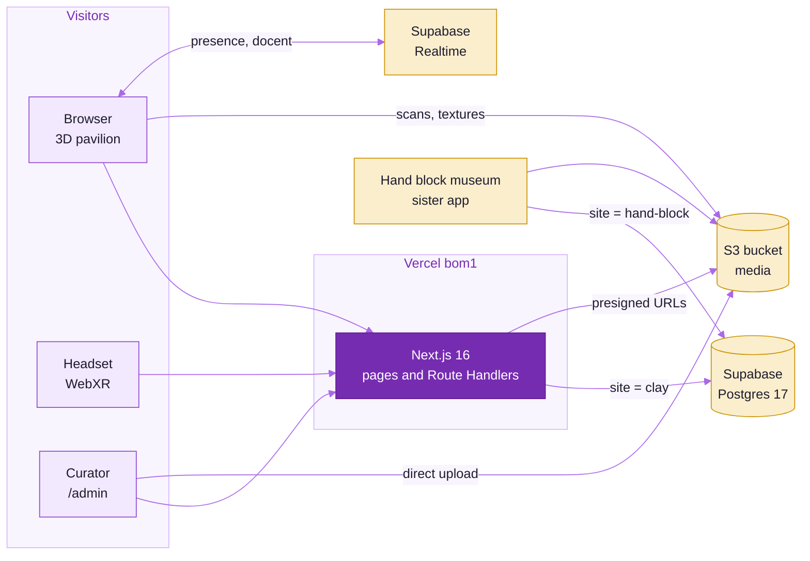
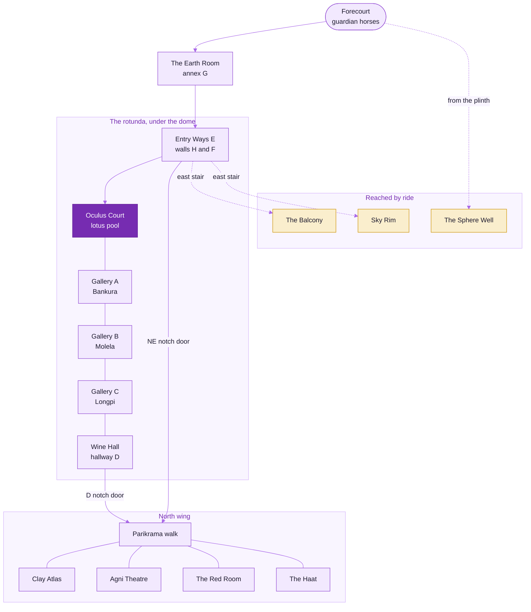
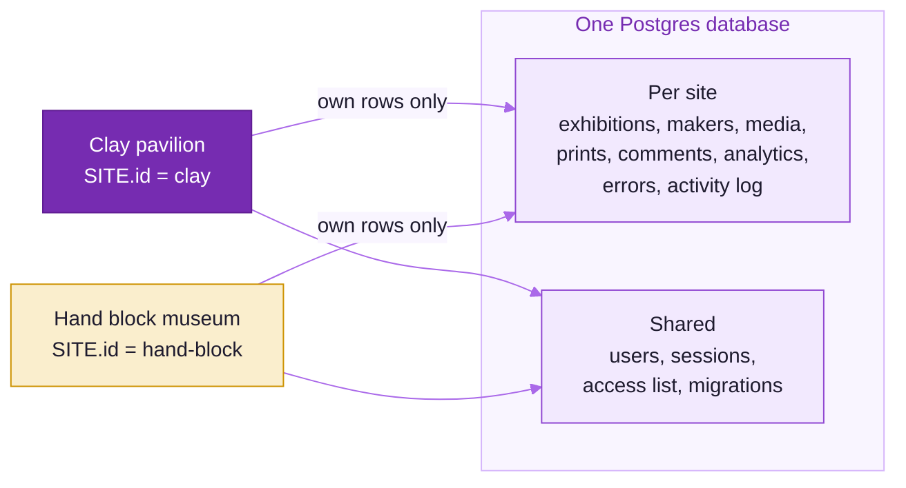
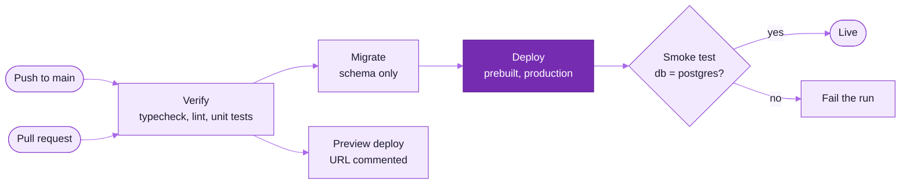

<picture>
  <source media="(prefers-color-scheme: dark)" srcset="docs/readme-kit/assets/hero-dark.svg">
  
</picture>

<p align="center">
  <picture>
    <source media="(prefers-color-scheme: dark)" srcset="https://readme-typing-svg.demolab.com?font=Plus+Jakarta+Sans&weight=600&size=20&duration=2800&pause=900&color=C090F5&center=true&vCenter=true&width=760&lines=Walk+the+clay+traditions+of+India;A+coffered+dome%2C+open+to+the+sky;Ride+to+the+oculus+rim%2C+or+down+the+Sphere+Well;Follow+a+live+docent%2C+or+step+in+with+VR">
    
  </picture>
</p>

<p align="center">
  
  
  
  
  <a href="https://clay-traditions.vercel.app"></a>
  <a href="https://github.com/cxacraftecosystem-ui/virtual-walkthrough-clay/actions/workflows/deploy.yml"></a>
</p>

A real-time 3D pavilion of India's clay traditions that runs in any modern browser, with no install and no
plug-in. It grows the *Clay exhibition layout* drawings into a rotunda: a coffered terracotta dome 32 m across,
open to the sky over a lotus pool, three galleries for Bankura, Molela and Longpi, and a north wing that gathers
eighteen more traditions, most in the Red Room. Visitors walk fifteen spaces, ride up to the oculus rim or down
into the Sphere Well, and follow a guided or live tour. It shares one database and one admin with the hand block
printing museum, and curators run every piece, maker and tour stop from there.

<picture>
  <source media="(prefers-color-scheme: dark)" srcset="docs/readme-kit/assets/stats-dark.svg">
  
</picture>

<picture>
  <source media="(prefers-color-scheme: dark)" srcset="docs/readme-kit/assets/divider-dark.svg">
  
</picture>

## &nbsp; What it does

<picture>
  <source media="(prefers-color-scheme: dark)" srcset="docs/readme-kit/assets/cards-dark.svg">
  
</picture>

| Feature | For | Where it lives | Read more |
|---|---|---|---|
| Walk, minimap, click-to-walk, guided tour | visitors | `src/museum/navigation`, `src/museum/tour` | [Pavilion guide](docs/MUSEUM.md#controls-and-url-parameters) |
| The 21 traditions, silent until confirmed | curators | `src/museum/content/crafts.ts`, `content/review.ts` | [Pavilion guide](docs/MUSEUM.md#the-traditions) |
| Rides to the balcony, Sky Rim and Sphere Well | visitors | `src/museum/navigation/perch.ts` | [Pavilion guide](docs/MUSEUM.md#rides-moments-and-the-passport) |
| Time of day, weather, diyas, path-traced photos | visitors | `src/museum/lighting`, `src/museum/effects` | [Graphics](docs/MUSEUM.md#light-and-graphics) |
| Kiln film, moments, the clay passport | visitors | `src/museum/spectacle`, `src/museum/media`, `src/museum/trail` | [Pavilion guide](docs/MUSEUM.md#rides-moments-and-the-passport) |
| Deep zoom and 3D scan import | curators | `src/admin/pipeline`, `src/server/handlers/deepzoom.ts` | [Capture guide](docs/CONTENT_CAPTURE.md) |
| Presence, live docent tours, VR and AR | visitors, staff | `src/museum/live`, `src/museum/xr` | [Live and XR](docs/MUSEUM.md#live-tours-presence-vr-and-ar) |
| Exhibitions, makers, history, trash, activity log | curators | `src/admin`, `src/server/contentStore.ts` | [API](docs/API.md) |
| Heatmaps, tour funnel, errors, CSV | admins | `src/server/handlers/curatorAnalytics.ts` | [Analytics](docs/API.md#analytics) |
| Printable guide, QR labels, maker pages, credits | visitors | `app/guide`, `app/qr`, `app/makers`, `app/credits` | [Pavilion guide](docs/MUSEUM.md#pages-outside-the-3d-view) |

## &nbsp; How it works

<picture>
  <source media="(prefers-color-scheme: dark)" srcset="docs/readme-kit/assets/pipeline-dark.svg">
  
</picture>

One Next.js 16 app serves the landing page, the 3D pavilion, the admin and the API. The pavilion renders with
Three.js r186 through React Three Fiber, loads its content from `/api/content` and falls back to the bundled
`src/museum/config` when the API cannot be reached. Media goes from the browser straight to S3 with presigned
URLs, so a large scan never passes through a function. `src/site.ts` makes this build the clay site, and every per-site
row it reads or writes carries `site = 'clay'`.



### Inside the rotunda

The drawings give a drum of about 70 ft with a 15 ft entrance; the build scales the gallery ring to 32 m across
under a dome that rises to 22 m round a 10 m oculus. Visitors start on the forecourt, walk in through the Earth
Room, pass the description wall H, and turn past the inner main wall F into the court.



<picture>
  <source media="(prefers-color-scheme: dark)" srcset="docs/readme-kit/assets/pipeline-tour-dark.svg">
  
</picture>

| Graphics tier | Starts on | Shadows | Post-processing | Spotlights | Extras |
|---|---|---|---|---:|---|
| Low | small touch screens | · | · | 6 | 512 px textures |
| Medium | tablets, 4 GB devices, integrated GPUs | 2048 px, soft | native MSAA, no composer | 10 | |
| High | discrete GPUs | 4096 px, soft | AO, bloom, SMAA | 12 | mirrored lotus pool |
| Ultra | flagship GPUs | 4096 px, soft | high AO, bloom, SMAA | 14 | mirrored pool, floor reflections, 2048 px textures |

The starting tier comes from `detectInitialTier()`, and the pavilion steps down a tier when it cannot hold about
32 fps. On Low below about 30 fps the costly extras switch off too. Visitors can change tier from the HUD.

## &nbsp; Built with

<p align="center">
  <picture>
    <source media="(prefers-color-scheme: dark)" srcset="https://skillicons.dev/icons?i=nextjs,react,ts,threejs,nodejs,postgres,supabase,sqlite,aws,vercel,githubactions&theme=dark&perline=11">
    
  </picture>
</p>

| Layer | Stack |
|---|---|
| Scene | Three.js r186, React Three Fiber 9, drei 10, postprocessing, three-gpu-pathtracer, three-mesh-bvh, `@react-three/xr` 6 |
| App | Next.js 16 (App Router, Route Handlers), React 19.3, zustand 5, OpenSeadragon 6 |
| Data | `pg` against Supabase Postgres 17, or `node:sqlite` locally; AWS SDK v3 for S3 |
| Capture | glTF Transform 4 and meshoptimizer in Web Workers, DZI tiling in the browser |
| Models | procedural clay models in `src/museum/models`, and freely licensed scans from Poly Haven, Wikimedia Commons, the Smithsonian and ambientCG in `public/models/sourced`, credited on `/credits` |
| Tooling | Node.js 24, TypeScript 7 for `typecheck` and TypeScript 6 for ESLint and `next build`, ESLint 10, `node:test` via `tsx` |

## &nbsp; Quick start

1. Install Node.js 24 and the dependencies.

   ```bash
   npm install
   ```

2. Start the dev server. Nothing needs configuring: SQLite (`.data/museum.sqlite`) and disk media
   (`.data/media`) are created on the first request.

   ```bash
   npm run dev
   ```

3. Open the pages.

   | Address | What |
   |---|---|
   | `http://localhost:3000/` | landing page, spaces and the experience |
   | `http://localhost:3000/gallery` | the pavilion (the `clay-traditions` exhibition) |
   | `http://localhost:3000/gallery?review` | curator review: every tradition's name and caption shows |
   | `http://localhost:3000/admin` | the admin; dev login `admin@museum.local` / `admin12345` |

4. Check a change the way CI will.

   ```bash
   npm run typecheck
   npm run lint
   npm test
   npm run build
   ```

Controls: drag to look (**L** for mouse-look), **WASD** or arrows to walk, **Shift** to walk briskly, click the
floor to walk there, click a piece for its details, **E** for the nearest item, **M** map, **T** time of day,
**P** photo mode, **H** help.

> [!CAUTION]
> Never set `USE_REMOTE=1` for everyday work: it points the dev server at the production database and bucket,
> which the hand block museum shares.

<picture>
  <source media="(prefers-color-scheme: dark)" srcset="docs/readme-kit/assets/divider-dark.svg">
  
</picture>

## &nbsp; Two museums, one database

This app and [`virtual-walkthrough`](https://github.com/cxacraftecosystem-ui/virtual-walkthrough), the hand block
printing museum, are two Vercel projects on one Supabase database and one S3 bucket. `src/site.ts` is the only
file that differs between the repositories by design.



| Rule | Why |
|---|---|
| `supabase/migrations/` and the SQLite mirror stay byte-identical in both repos | the runner pins each applied file by sha256 and refuses to start on a changed file |
| Every migration is additive, with constant defaults | the other app's deployed code keeps running against the new schema |
| `ADMIN_*`, `MASTER_ADMIN_EMAILS`, `LIVE_TOKEN_SECRET`, `S3_PREFIX` match in both deployments | otherwise each cold start re-syncs masters and revokes the other app's admin sessions |
| `NEXT_PUBLIC_LIVE_ROOM` differs, or is left unset | each app falls back to its own room, `clay-pavilion` here |
| Meta keys this app owns start with `clay:` | seeding one site never counts as seeding the other |
| Deploy hand-block first | this app refuses to start until `sites_aware:hand-block` is recorded |

The full contract and env vars are in [docs/BACKEND.md](docs/BACKEND.md#two-museums-one-database).

## &nbsp; Roles and security

| Role | Admin pages | Can |
|---|---|---|
| visitor | none | favourites, guestbook and comments |
| curator | Home, Checklist, Activity, Content, Exhibitions, Makers, Media, Capture tools, Visitor prints | edit content, makers and the tour; upload media; moderate visitor pieces |
| admin | + Comments, Analytics, Errors, Users | + reset content, moderate comments, manual roles, analytics retention |
| master | Users & access | + the access list; set by `MASTER_ADMIN_EMAILS` |

| Control | How |
|---|---|
| Passwords and sessions | scrypt; 32-byte tokens stored as SHA-256 hashes; 30-day `HttpOnly`, `SameSite=Lax` cookie |
| Google sign-in | ID token checked against Google's JWKS with `jose`, `aud` pinned to `GOOGLE_CLIENT_ID` |
| Access list | elevates verified (Google) addresses only; recomputed on every sign-in and change |
| Requests | every admin route checks its role server-side; foreign `Origin` refused on writes |
| Database | TLS verified against the bundled Supabase root; RLS on with no policies, so the anon key reads nothing |
| Uploads | extension allow-list, 500 MB cap, random names, `nosniff`, no HTML or SVG; admin media URLs checked before rendering |
| Live tours | every docent message signed with ECDSA P-256 and bound to an HMAC token from the server |
| Analytics | a random session id from Web Crypto; no IP, user agent or account stored |

## &nbsp; CI and deploy



| Workflow | Runs on | Does |
|---|---|---|
| `deploy.yml` | push to `main`, pull requests, dispatch | typecheck, lint and unit tests; on `main`, production migrations with the `DATABASE_URL` secret, a prebuilt Vercel deploy (`vercel pull`, `vercel build --prod`, `vercel deploy --prebuilt --prod`) and a smoke test; a preview deploy per pull request. Pushes that change only Markdown, `docs/` or the README check skip it, and `ignoreCommand` in `vercel.json` stops Vercel's own Git builds. |
| `ci.yml` | pull requests, dispatch | unit tests again against a Postgres 17 service, so the query-count tests check real SQL; visual regression once baselines are committed in `tests/visual/baseline` |
| `readme-check.yml` | README, `docs/` or kit changes | kit assets match `kit.json`, SVG safety rules, xmllint, image budgets, every mermaid block renders on github.com, preview PNGs |

## &nbsp; Documentation

| Question | Read |
|---|---|
| How is the rotunda built, and how do I place a piece or change the light? | [docs/MUSEUM.md](docs/MUSEUM.md) |
| How do the backend, admin, sign-in and deploy work? | [docs/BACKEND.md](docs/BACKEND.md) |
| What does each endpoint take and return? | [docs/API.md](docs/API.md) |
| How do we photograph reliefs and scan pots? | [docs/CONTENT_CAPTURE.md](docs/CONTENT_CAPTURE.md) |
| What material is the workshop still to send? | [docs/CONTENT_STILL_NEEDED.md](docs/CONTENT_STILL_NEEDED.md) |
| How is Vercel, Supabase or S3 set up? | [infra/deploy-vercel.md](infra/deploy-vercel.md), [infra/setup-supabase.md](infra/setup-supabase.md), [infra/setup-s3.sh](infra/setup-s3.sh) |
| How do visual baselines work? | [tests/visual/README.md](tests/visual/README.md) |
| How is this README built? | [docs/readme-kit/README_STYLE.md](docs/readme-kit/README_STYLE.md) |

## &nbsp; Status

<picture>
  <source media="(prefers-color-scheme: dark)" srcset="docs/readme-kit/assets/timeline-dark.svg">
  
</picture>

Production is [clay-traditions.vercel.app](https://clay-traditions.vercel.app), deployed from `main` by
`deploy.yml`. Every piece of the traditions is still a stand-in: titles name the form ("Kettle — Study"), never a tradition, and
the twenty-one traditions' names, places and captions stay silent until the workshop confirms the list. The
list of what is still to come is in [docs/CONTENT_STILL_NEEDED.md](docs/CONTENT_STILL_NEEDED.md).

<picture>
  <source media="(prefers-color-scheme: dark)" srcset="docs/readme-kit/assets/footer-dark.svg">
  
</picture>
