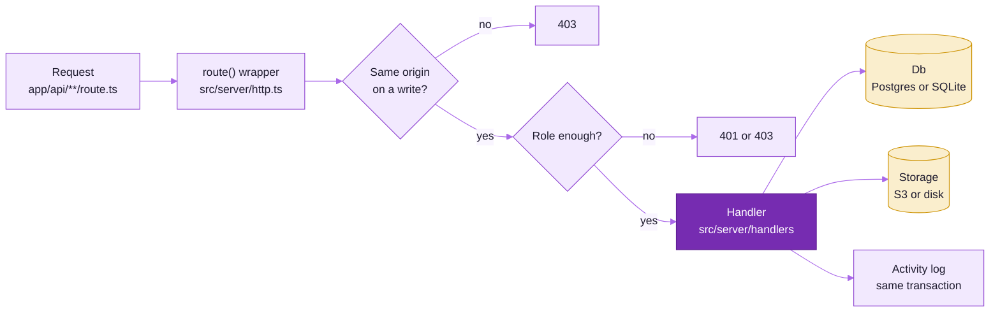
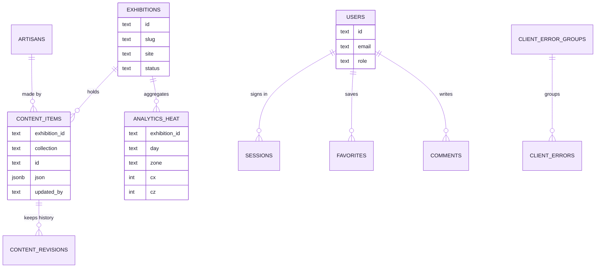
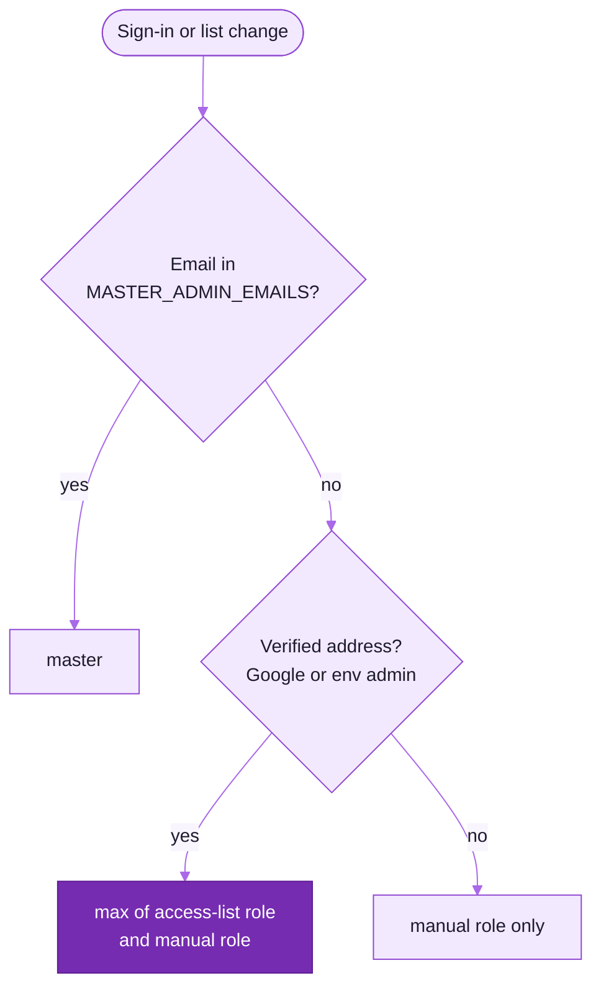
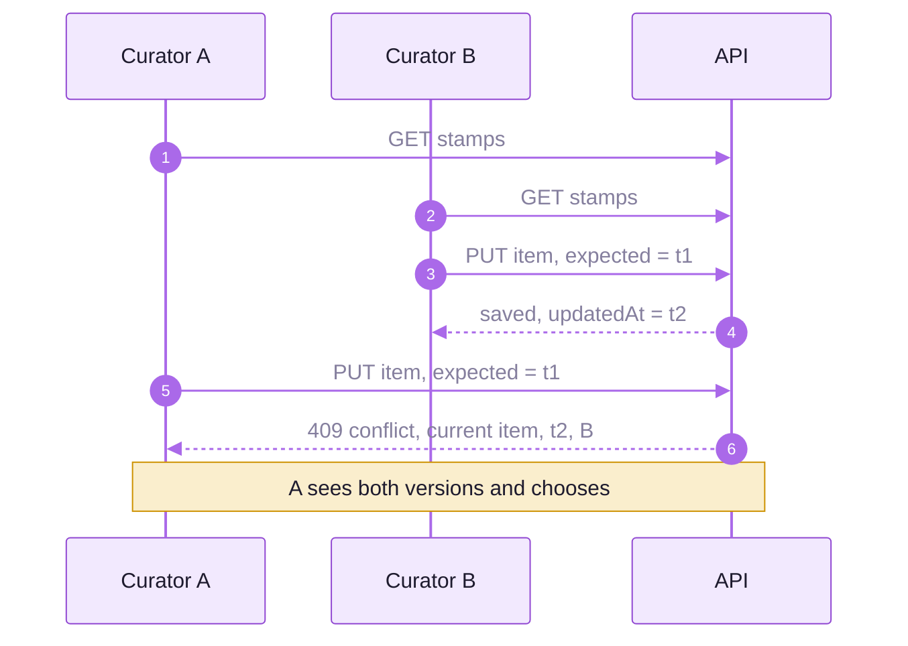
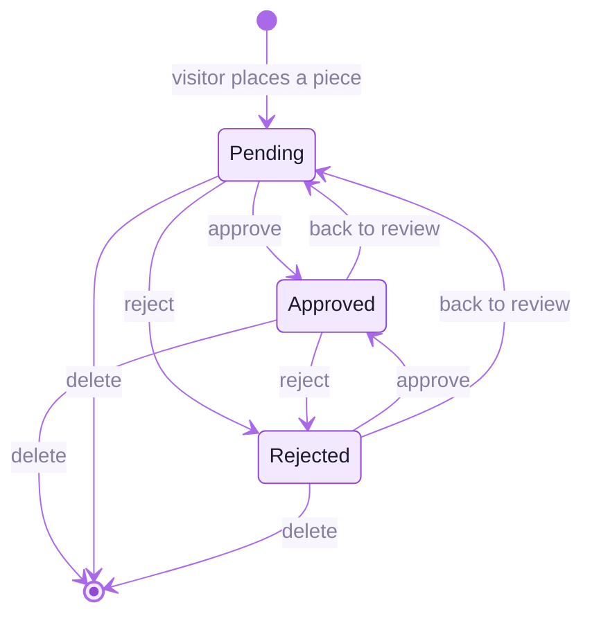
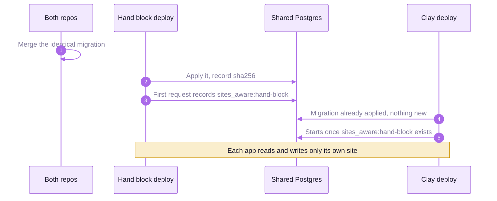

<picture>
  <source media="(prefers-color-scheme: dark)" srcset="readme-kit/assets/divider-dark.svg">
  
</picture>

# &nbsp; Backend and admin

The pavilion runs as a pure static experience from the bundled `src/museum/config`, and the same Next.js app
also hosts a backend: editable content per exhibition, a media library, makers, visitor accounts (favourites,
guestbook, comments), visitor pieces, anonymous analytics, client error reports and the admin. The backend, the
admin and the migrations are byte-identical with the hand block printing museum's; this build answers for
`site = 'clay'` only. Every endpoint is in [API.md](API.md).

| Section | What it covers |
|---|---|
| [Two modes](#two-modes) | SQLite and disk locally, Postgres and S3 in production |
| [Where things live](#where-things-live) | the server code map |
| [The admin](#the-admin) | pages, roles and the curator workflow |
| [Roles and the access list](#roles-and-the-access-list) | who may do what, and how it is decided |
| [Google sign-in](#google-sign-in) | setting up the OAuth client |
| [Content, history and conflicts](#content-history-and-conflicts) | versions, revisions, trash, stale saves |
| [Exhibitions, makers and analytics](#exhibitions-makers-and-analytics) | multi-exhibition, maker profiles, heatmaps, retention |
| [The potter's wheel and the Visitors' Shelf](#the-potters-wheel-and-the-visitors-shelf) | the studio, taken down for now, and moderation |
| [Two museums, one database](#two-museums-one-database) | site scoping with the hand block museum |
| [Deploy](#deploy) | Vercel, GitHub Actions, shared resources |
| [Security](#security) | the controls in one table |

## Two modes

| | Local (default) | Production |
|---|---|---|
| Database | SQLite through Node's built-in `node:sqlite` → `.data/museum.sqlite` (`DB_PATH`) | Supabase Postgres 17 through `DATABASE_URL`, TLS verified |
| Media | disk → `.data/media/<folder>/…` (`MEDIA_DIR`), served at `/media/…` with Range and ETag | S3 (`S3_BUCKET`, `AWS_REGION`, `S3_PUBLIC_BASE_URL`, `S3_ENDPOINT`, `S3_PREFIX`) with presigned direct uploads |
| Hosting | `npm run dev`, or `npm run build && npm start` | Vercel, pages and Route Handlers as Node functions in `bom1` |

`DATABASE_URL` switches the database and `S3_BUCKET` switches storage, independently. Every variable is in
`.env.example`. On the first API request the server creates the database, makes sure the `clay-traditions`
exhibition exists, seeds it from the bundled config and creates the admin account.

Production credentials can sit in `.env.local` as `REMOTE_DATABASE_URL`, `REMOTE_S3_BUCKET`,
`REMOTE_ADMIN_PASSWORD` and so on; they are ignored unless `USE_REMOTE=1`, so `npm run dev` keeps using SQLite
and local disk.

> [!CAUTION]
> Never run `vercel env pull .env.local`: it overwrites the file with plain `DATABASE_URL` and points local
> development at the production database, which the hand block museum shares.

```bash
npm run db:migrate                     # apply supabase/migrations to DATABASE_URL (or create SQLite), seed if empty, re-sync staff roles
USE_REMOTE=1 npm run db:migrate        # the same against the REMOTE_* settings
npm run db:migrate -- --schema-only    # migrations only, as CI runs it
USE_REMOTE=1 npm run db:tls-check      # read-only: the server certificate verifies (infra/setup-supabase.md §3)
```



## Where things live

| Path | What |
|---|---|
| `app/api/**/route.ts` | thin Route Handlers, one per endpoint |
| `app/media/[...path]` | local media with Range and ETag; redirects to S3 in S3 mode |
| `app/admin/`, `src/admin/` | the admin page and its client app |
| `src/site.ts` | which museum this build is: `SITE.id = 'clay'`, the default exhibition, the live room, the meta prefix |
| `src/server/db/` | the `Db` interface, `PostgresDb` (`pg`), `SqliteDb` (`node:sqlite`) and the migrations runner |
| `src/server/storage.ts` | `LocalDiskStorage` and `S3Storage` with presigned PUT |
| `src/server/auth.ts` | scrypt passwords, DB-backed sessions, roles, access-list resolution |
| `src/server/contentStore.ts` | content rows, version, revisions, seeding from the bundled content |
| `src/server/site.ts` | the site every query is scoped to, `metaKey()`, `runAsSite()` for tests |
| `src/server/audit.ts` | the activity log |
| `src/server/handlers/` | content, exhibitions, artisans, auth, favourites, comments, prints, media, deep zoom, analytics, curator analytics, errors, users, live, overview |
| `supabase/migrations/` | the Postgres schema, mirrored for SQLite in `src/server/db/sqlite.ts` |



Other tables: `meta`, `media`, `visitor_prints`, `analytics_events`, `analytics_batches`, `access_list`,
`audit_log` and `_museum_migrations`. Per-site tables carry a `site` column.

## The admin

`/admin` follows the field repository design system in light and dark, with a dashboard, a command palette,
keyboard shortcuts per page and an exhibition switcher that scopes every content page.

| Group | Page | From role | What it does |
|---|---|---|---|
| Overview | Home | curator | counts, the exhibition's state and the latest activity |
| | Checklist | curator | what each item still lacks (material, media, alt text, translations, maker, placement), with a CSV for the workshop |
| | Activity | curator | the activity log, filtered to what the role may read |
| Content | Content | curator | typed editors per collection, history with restore, trash, conflict checks |
| | Exhibitions | curator | create, duplicate, publish and set the default (admin); the visual tour editor (curator) |
| | Makers | curator | maker profiles and where they are used |
| Media | Media library | curator | paged, searchable media with usage checks before delete |
| | Capture tools | curator | deep zoom tiling and 3D scan import, in the browser |
| Visitors | Visitor prints | curator | the review queue for pieces visitors place on the Visitors' Shelf |
| | Comments | admin | hide, unhide, delete and bulk moderation |
| Insights | Analytics | admin | heatmap on the rotunda's plan, tour funnel, attention ranking, CSV, retention |
| | Errors | admin | grouped client errors, resolve and reopen |
| Settings | Users (Users & access for master) | admin | manual roles; the access list for master admins |

Curators also get placement and tour tools inside the pavilion itself (staff mode). The heatmap draws on
`FLOOR_PLAN` from `src/museum/config/plan.ts`, the same plan the minimap uses.

## Roles and the access list

| Role | Can |
|---|---|
| visitor | favourites, guestbook and comments |
| curator | create, edit and delete content, makers, exhibition and welcome text, the tour; upload and delete media; moderate visitor pieces |
| admin | + reset content to the bundled defaults, moderate comments, analytics, errors, the user list and manual roles |
| master | + the access list; every verified account whose email is in `MASTER_ADMIN_EMAILS` (fallback `MASTER_ADMIN_EMAIL`, then `ADMIN_EMAIL`) |

Every admin Route Handler enforces the minimum role server-side (`requireCurator()`, `requireAdmin()`,
`requireMaster()` in `src/server/http.ts`; 401 signed out, 403 too low). The admin UI only hides what a role
cannot use. Users, sessions and the access list are shared with the hand block museum, so a curator signs in once
and has the same role in both admins.



The access list (master only) holds emails (`person@iitkgp.ac.in`) or whole domains (`@iitkgp.ac.in`) with the
role they grant, curator or admin. The effective role is recomputed on every sign-in, whenever the list changes
and at start-up. Master addresses are mirrored into the list as read-only `master` rows on every start and
`db:migrate`; removing an address from the env var removes its row and rights. Because both apps re-sync those rows
on every cold start, `MASTER_ADMIN_EMAILS` must be the same in both deployments.

Access-list roles apply only to verified addresses, because password sign-up does not prove email ownership.
Staff sign in with Google once; afterwards password sign-in keeps the role too. Linking Google to an unverified
password account with the same email clears that password and revokes its sessions.

Admin credentials come from `ADMIN_EMAIL` and `ADMIN_PASSWORD`. Without them, in development only,
`admin@museum.local` / `admin12345` is created with a warning. When both are set, the account is created on first
start and its password is re-synchronised on every cold start. In production no default admin is ever created.

## Google sign-in

*Sign in with Google* (Google Identity Services) appears on `/admin` and in the pavilion's sign-in dialog when
`GOOGLE_CLIENT_ID` is set (`GET /api/auth/providers`). The browser posts the ID token to `POST /api/auth/google`;
the server verifies it against Google's JWKS with `jose` (signature, issuer, audience, expiry, `email_verified`),
finds or creates the user, sets the session cookie and applies the access list.

1. Use the hand block museum's OAuth client, so staff keep one Google sign-in across both apps.
2. Google Cloud Console → *APIs & Services* → *Credentials* → that **Web application** client.
3. *Authorised JavaScript origins*: add `https://clay-traditions.vercel.app` and, for local work, the dev origin.
   No redirect URIs (popup flow).
4. Put the same client id in `GOOGLE_CLIENT_ID` (`.env.local` and Vercel). Origins take a few minutes to apply.

## Content, history and conflicts

The pavilion loads `/api/content` at start-up and falls back to bundled content when the API is unreachable.
Every save bumps `MuseumContent.version`. **Reset to bundled defaults** re-seeds an exhibition from
`src/museum/config`; what it replaces stays in the trash.

Every save, delete and restore is kept as a revision (the last 100 per item), and every admin change writes one
line to the activity log. An editor sends the stamp it loaded as `X-Expected-Updated-At`, so a save that would
overwrite a colleague's newer change is refused:



On Postgres the check and the write are one step under a transaction lock on the item, so two simultaneous
saves are served one after the other.

## Exhibitions, makers and analytics

| Feature | How |
|---|---|
| Multi-exhibition | one building, several exhibitions (`exhibitions`, `content_items.exhibition_id`). The default, `clay-traditions` ("Clay Traditions", *Earth, water, hand and fire*), opens at `/gallery`, others at `/gallery/<slug>`. Each has its own artworks, exhibits, panels, films, objects, description-wall and welcome text, tour override and accent colour. The entry screen lists exhibitions when more than one is published. |
| Meet the maker | profiles in `artisans`; artworks and objects link one with `artisanId`. The info panel shows a maker card with *Visit the maker*, *Commission* and *Buy (fair trade)* for the links that exist; `/makers/<id>` is the accessible page. The seeded stand-in profiles stay hidden from visitors until *Hidden from visitors* is cleared. |
| Curator analytics | the tracker samples the visitor's position every 2 s and tour arrivals; on a ride it reports the perch's zone. Positions are aggregated on arrival into `analytics_heat` (0.5 m cells per exhibition, day and zone) and never stored raw. Floor-plan heatmap, zone filter, date range, tour funnel, attention ranking, CSV export. |
| Batches once | each batch carries an id made in the browser and is resent unchanged after a failure; the server stores each id once per session (`analytics_batches`), so a lost reply never double-counts. |
| Retention | analytics older than the retention setting (default 180 days, per site) are deleted at most once a day, batch ids after 31 days; also `POST /api/admin/analytics/cleanup`, or `GET` or `POST` with `Authorization: Bearer $CRON_SECRET` from a scheduled job. |
| Error monitoring | browser errors, unhandled rejections, contained React errors and WebGL context loss are sampled, scrubbed and sent to `POST /api/errors`, then grouped on the **Errors** page; set `NEXT_PUBLIC_SENTRY_DSN` to also forward them to Sentry without an SDK. |

## The potter's wheel and the Visitors' Shelf

| Piece | How |
|---|---|
| Studio | `src/museum/studio/ClayStudio.tsx`, the full-screen *Shape it yourself* wheel: drag the profile or use the tools (pull up, widen, narrow, trim the rim, turn a foot), choose a clay body, slip, glaze and burnish, add sgraffito or stamped bands, fire it; undo, redo, PNG download. |
| Visitors' Shelf | *Place it on the Visitors' Shelf* sends a turntable shot through `POST /api/prints` for the same curator review as the hand block museum's Visitors' Wall; approved pieces come back from `GET /api/prints?status=approved`. Offline or `?static`, the studio still works and downloads. |
| Status | taken down for the time being: `GRAND_FLAGS.clayStudio` in `config/museum.ts` is `false`, so neither the wheel nor the shelf stands in the pavilion, and the *Visitor prints* queue stays empty. Setting it to `true` restores both. |



Submissions are rate-limited per session and per IP, at most six may wait per session, and new ones are refused
while 400 wait for review.

## Two museums, one database

This app (the clay pavilion) and
[`virtual-walkthrough`](https://github.com/cxacraftecosystem-ui/virtual-walkthrough) (the hand block printing
museum) are two Vercel projects that share one Supabase database and one S3 bucket. `src/site.ts` decides which
museum a build is (`SITE.id`: `clay` here, `hand-block` there) and is the only file that differs between the two
repositories by design.

| Concern | Rule |
|---|---|
| Site scoping | exhibitions, makers, media, visitor prints, comments, favourites, analytics events and heatmap, client errors, content revisions and the activity log carry `site` (`supabase/migrations/20261101000000_sites.sql`); every query filters by it, and every by-id admin route answers 404 for the other site's rows. Content items are scoped through their exhibition. Rows from before sites belong to `hand-block`. |
| Shared on purpose | users, sessions and the access list, so staff keep one login and one role; analytics batch markers and the migration ledger. |
| Meta keys | prefixed by `metaKey()`: `clay:` here, none for hand-block; the content `version` is shared. |
| Seeding | this app creates `clay-traditions` on its first start and seeds only into it; it never seeds, resets or deletes the other site's exhibitions. Exhibition slugs and maker ids are unique across both; a clash is a clear 409, so a new exhibition here must not reuse an id from the museum. |
| Identical env vars | `ADMIN_EMAIL`, `ADMIN_PASSWORD`, `MASTER_ADMIN_EMAILS`, `LIVE_TOKEN_SECRET`, `S3_PREFIX`, `DATABASE_URL`, `S3_BUCKET`, `S3_PUBLIC_BASE_URL`, `AWS_REGION`. Different admin values make each cold start undo the other app; a different `S3_PREFIX` breaks every media address the other app stored. |
| Different env vars | `NEXT_PUBLIC_LIVE_ROOM` (leave it unset and this app uses `clay-pavilion`), `NEXT_PUBLIC_SITE_URL`, and the Google OAuth origins. |
| Migrations | byte-identical in both repos, SQLite mirror too. The runner records each file's sha256, refuses to start on a changed file, warns when the database has a migration this build lacks, and serialises on a Postgres advisory lock. Every migration is additive, with constant defaults, and never changes a constraint an `ON CONFLICT` names. |
| Start order | each app records `sites_aware:<site>` in the shared `meta` table. This app does not create its exhibition and refuses to start while the hand block museum has served the database (`seeded_at`) and `sites_aware:hand-block` is missing. |



The S3 CORS rule lists the clay origins (`https://clay-traditions.vercel.app`, its previews
`https://clay-traditions-*.vercel.app` and `http://localhost:3001`) for direct uploads (`infra/s3-cors.json`).
Details: [infra/deploy-vercel.md](../infra/deploy-vercel.md) → *The second app*.

## Deploy

| Path | How |
|---|---|
| Vercel | set the env vars from `infra/deploy-vercel.md` with the rules above. Uploads go browser → S3 with presigned URLs. |
| GitHub Actions | `deploy.yml` on every push to `main`: typecheck, lint and unit tests, `npm run db:migrate -- --schema-only` with the `DATABASE_URL` secret, `vercel pull`, `vercel build --prod` and `vercel deploy --prebuilt --prod`, then a smoke test that `/api/health` reports `"db":"postgres"` and `/` and `/gallery` answer 200, against the `SITE_URL` repository variable (it falls back to the hand block address when unset). Pull requests get a preview deploy on the same database. Pushes that change only Markdown, `docs/` or the README check do not deploy, and `ignoreCommand` in `vercel.json` keeps Vercel's own Git integration from building. Secrets: `VERCEL_TOKEN`, `VERCEL_ORG_ID`, `VERCEL_PROJECT_ID`, `DATABASE_URL`. |
| One Node process | `npm run build && npm start` with `DATABASE_URL` (or SQLite on a persistent disk) and optionally `S3_BUCKET`, behind HTTPS (the session cookie is `Secure` in production; `COOKIE_SECURE=0` only for plain-HTTP tests). |

| Resource | Value |
|---|---|
| Supabase project | `hand-block-museum`, ap-south-1, shared with the hand block museum |
| S3 bucket | `hand-block-museum-media-626159998512`, ap-south-1, shared, with the CloudFront CDN in `S3_PUBLIC_BASE_URL` (`infra/cloudfront.md`) |
| Vercel | functions in `bom1` (`vercel.json`), production at `https://clay-traditions.vercel.app` |

Setup guides (they create cloud resources; read them first): `infra/setup-supabase.md`, `infra/setup-s3.sh` with
`infra/s3-cors.json`, `infra/deploy-vercel.md`.

## Security

| Area | Control |
|---|---|
| Passwords | scrypt, N=16384, r=8, p=1, 16-byte salt |
| Sessions | 32-byte random tokens, only the SHA-256 stored; 30-day `HttpOnly; SameSite=Lax` cookie, `Secure` in production |
| Rate limits | login 10 a minute per IP, comments 5 a minute per user, Google sign-in 20 a minute per IP |
| CSRF | state-changing calls with a foreign `Origin` are refused, on top of SameSite |
| Uploads | allow-list (jpg, png, webp, glb, gltf, mp4, webm, mp3, ogg, wav, m4a), 500 MB, random names, `nosniff`; no HTML or SVG; admin media addresses are checked before rendering |
| Database | the server certificate is verified against the Supabase root the app carries; a URL whose TLS parameters would override that is refused; RLS on with no policies, so the public anon key reads nothing |
| Roles | enforced server-side on every admin route; access-list elevation needs a verified email |
| Google | ID tokens verified locally against Google's rotating JWKS, `aud` pinned to `GOOGLE_CLIENT_ID` |
| Analytics | a random session id from Web Crypto only; no IPs, user agents or accounts |
| Deployments | always set `ADMIN_EMAIL` and `ADMIN_PASSWORD` for a shared deployment; never commit `.env*` |

<picture>
  <source media="(prefers-color-scheme: dark)" srcset="readme-kit/assets/footer-dark.svg">
  
</picture>
