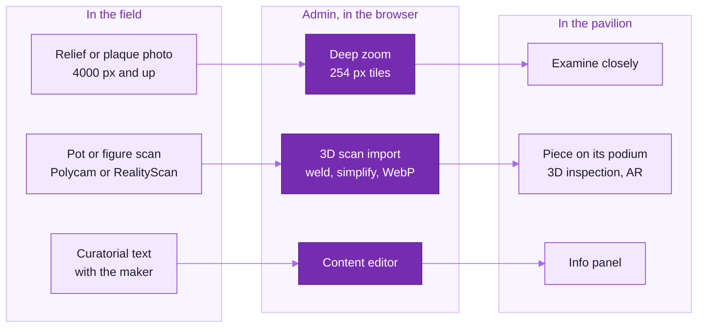

<picture>
  <source media="(prefers-color-scheme: dark)" srcset="readme-kit/assets/divider-dark.svg">
  
</picture>

# &nbsp; Content capture guide: reliefs, pots, text

A practical field guide for the workshop team: how to photograph reliefs, plaques and pots for the pavilion and its
**"Examine closely"** deep-zoom viewer, how to scan a pot, a horse or a figure with a phone, how to write the
curatorial text, and how to load everything through the admin (`/admin` → **Capture tools**).

> Nothing in the pavilion should state a fact that the workshop has not supplied. Leave a field empty rather than
> guess: the pavilion only shows the fields you fill in. Visitors never see a "placeholder" label: items still
> ticked *Needs content from the workshop* simply show what they have (see
> [CONTENT_STILL_NEEDED.md](CONTENT_STILL_NEEDED.md) for what is outstanding).

| Material | Minimum | Tool in the admin | Visitors see |
|---|---|---|---|
| Relief, plaque or tile photograph | 4 000 px long side, 50 px/cm | *Capture tools → Deep zoom* | **Examine closely**, with a cm scale bar |
| Pot, horse or figure scan | 80 to 150 photos, glTF or GLB | *Capture tools → 3D scan import* | the piece on its podium, 3D inspection, AR |
| Studio photograph of each piece | plain ground, 45° light | *Media*, then the item's image | the info panel, the fallback when 3D is not possible |
| Text | title; the rest only if the workshop vouches for it | *Content* | the info panel, the guide, translations |

---

## 1. Photographing reliefs, plaques and tiles

### What we need

| | Minimum | Good | Best |
|---|---|---|---|
| Long side of the final image | 4 000 px | 8 000 px | 12 000 px and up (stitched, for large panels) |
| Resolution on the object | 50 px/cm | 100 px/cm | 200 px/cm (tool marks and grit visible) |
| File | JPEG quality 95 | 16-bit TIFF → JPEG q95 export | RAW → TIFF master, JPEG export for upload |

The browser tiler accepts JPEG, PNG and WebP up to 16 384 px on the long side (larger files are reduced
automatically, and the admin says so). Keep the master in the archive.

### Set-up

- **Square on.** Stand the relief or plaque against a neutral grey board, or lay it flat on grey felt with the
  camera on a copy stand. Sensor parallel to the face: check with a spirit level on both.
- **Lens.** A 50 to 100 mm prime at f/8 to f/11: reliefs have depth, so stop down until the raised and the sunk
  parts are both sharp. Tripod, 2 s timer or remote, stabilisation off, ISO 100.
- **Focus** manually, magnified on the highest point of the relief, then check the background plane.

### Light

- **Two identical lights at 45°** for the colour shot: daylight-balanced (5000 to 5600 K, CRI ≥ 95), even within
  ⅓ stop corner to corner.
- **Raking light** for relief: one light at 15 to 25° from the upper left, a white card opposite as fill. This is
  the picture that shows the modelling; shoot it as well, and upload it as the wall image if curators prefer it.
- **Painted plaques** (Molela): add cross-polarisation (polariser film on the lights, circular polariser on the
  lens) so the paint reads without glare.
- No mixed light: switch off room lights and block windows.

### Colour and scale

- A **colour card** (X-Rite ColorChecker or similar) and a **ruler with cm marks** in a first reference frame under
  the same light; custom white balance from the card's neutral patch; export in **sRGB**. Fired clay is easy to
  oversaturate: leave saturation and clarity alone.
- **Measure** the width of the photographed area in cm and enter it in the Deep zoom tool. It drives the scale bar
  and hangs the work 1:1 (`physicalWidth`).

### File naming

`<accession-or-id>_<short-title>_<view>.jpg`, for example `CLAY-B-007_rider-plaque_front.jpg`. No spaces or
personal names.

---

## 2. Scanning pots, horses and figures

The pieces on the podiums, the islands and the niches are shown in 3D. A phone photogrammetry scan is enough: use
**Polycam** or **RealityScan** in **photo mode** (LiDAR is too coarse).

### Set-up

- Soft, even light (overcast shade, or two soft boxes). No hard shadows.
- A **turntable** on a plain, textured mat (newspaper works: the app needs texture to track). A ruler beside the
  piece for the first photos.
- **Burnished and black pottery (Longpi) is shiny**, and shine breaks photogrammetry. Do not spray or powder an
  object to dull it. Use cross-polarised light instead (polariser film on the lights, circular polariser on the
  lens, rotated until the highlights vanish), or very large, very soft light from all round.
- **Hollow pieces** (Bankura horses are open beneath and behind): scan the outside; the interior does not need to be
  complete.

### Capture

- 80 to 150 photos: three rings (low ≈ 15°, middle ≈ 45°, high ≈ 70°), one every ~10°, the piece filling about
  60 % of the frame, then close-ups of the rim, handles, spout and any mark or stamp.
- Turn the piece over for the base if it can be handled safely; otherwise scan it standing.
- Focus and exposure locked, no motion blur.

### Processing and export

- Polycam: *Process → Full detail*, crop the ground away, **Export → GLB**.
- RealityScan: *Process in the cloud*, crop, **Export → GLB**.
- Do not decimate in the app: the admin's importer does it more carefully (section 4).

Also take one **studio photograph** of each piece (the section 1 set-up, 45° light, plain ground). It is the
information-panel image and the fallback when 3D is not possible.

---

## 3. Writing the curatorial text

Each work and piece has these fields (all optional except the title). Write in plain English; Hindi and Bengali
have their own fields (*Translations* group in the Content editor).

| Field | Guidance |
|---|---|
| **Title** | The name the workshop or the maker uses for the piece. Until then the pavilion uses a form title such as "Kettle — Study". |
| **Tradition / Region** | The tradition and the place as the workshop names them (for example "Longpi pottery", "Longpi, Ukhrul, Manipur"). |
| **Artisan** | Only with the maker's consent, spelt as they write it. Link a *Maker profile* if one exists. |
| **Material / Technique / Year** | Short facts the workshop can vouch for ("Red clay, wheel-thrown in parts, open-fired"). Leave "Year" empty if unknown; never estimate. |
| **Description** | 60 to 120 words: what the visitor is looking at and what to notice (the joins of a thrown horse, the slip, the tool marks, the burnish). Present tense. |
| **Context** | 60 to 150 words: how and by whom this kind of piece is made and used today, only what the workshop has told you. |
| **Alt text** | One sentence describing the object for blind visitors ("A round black clay kettle with a cane-wrapped handle"). |
| **Metadata** | Accession number, dimensions, photographer credit, copyright or licence. |

Style: short sentences, no superlatives, explain a local word the first time it is used, cite oral sources as
"according to …". Ask the maker to read their own entry before it goes live.

The wall panels need the same reading: *Three traditions of clay* on the description wall, the three tradition
panels (`tradition-a`, `tradition-b`, `tradition-c`), the five making panels in the Wine Hall (`process-prepare`,
`process-form`, `process-dry`, `process-fire`, `process-finish`) and the statement *Earth, water, hand and fire*.
They were written from general sources. The twenty-one tradition captions in `src/museum/content/crafts.ts` are the
researcher's, with Hindi and Bengali working translations, and show only in curator review (`/gallery?review`) until
the list is confirmed. When the real text and image are in, untick **Needs content from the workshop**.

---

## 4. Loading everything through the admin

Sign in at `/admin` (curator role or higher). All processing happens **in your browser**, so use a desktop Chrome or
Edge with at least 8 GB of RAM for large photos.

### A. Photograph → deep zoom

1. **Capture tools → Deep zoom.** Choose the **artwork**, then the photograph.
2. Check the pixel size and tile count; *JPEG* (universal) or *WebP* (smaller), quality 85. Enter the **physical
   width in cm**.
3. **Create deep zoom & assign.** The photo is sliced into a Deep Zoom Image pyramid (254 px tiles, 1 px overlap) in
   a background worker and uploaded with progress, direct to S3 when configured. The server writes `image.dzi`,
   records the pyramid in the media library, and the artwork's `deepZoom` field is set. Visitors open it with
   **Examine closely** or by double-clicking the work.
4. Upload a ~2 048 px JPEG through **Media** and set it as the artwork's **Image** (what hangs in 3D). Deleting the
   pyramid's media record deletes all of its tiles.

### B. Scan → 3D model

1. **Capture tools → 3D scan import.** Choose the `.glb` (or the `.gltf` with its `.bin` and textures).
2. Set the **triangle budget** (40 to 60 k for a pot or a horse), **max texture** (2 048 px) and the piece's **real
   height in cm** (Y up). Pick *Z up* only if the preview shows it on its side.
3. **Optimise.** The model is de-duplicated, welded, simplified with meshoptimizer, its textures resized and
   re-encoded as WebP, re-centred with its bottom at 0 and scaled to metres, then meshopt-compressed. Check the
   before and after table and the **3D preview** (grid = 10 cm).
4. **Upload & assign** to the **Scene object** that stands in for the piece: the podium pieces `clay-a-horse`,
   `clay-a-horse-small`, `clay-a-pot`, `clay-b-plaque-rider`, `clay-b-cups`, `clay-b-plaque-deity`, `clay-b-lamp`,
   `clay-b-plaque-serpent`, `clay-c-kettle`, `clay-c-bowl`, `clay-c-pot`, and the `craft-*` pieces of the herd, the
   niches, the islands, the register, the Parikrama and the Red Room. This sets `model`; the procedural stand-in is
   then only a loading fallback. A podium top is 30.5 cm square: a piece wider than about 28 cm needs a curator's
   decision.
5. Fill in the text (section 3) and untick *Needs content from the workshop*.

### Checklist before publishing

- [ ] Colours checked against the real piece on a calibrated screen
- [ ] Physical width entered (the scale bar shows plausible cm)
- [ ] 3D piece the right size against the 10 cm grid; it sits on its podium without floating or sinking
- [ ] Text read and approved by the workshop and the maker; translations reviewed by a native speaker
- [ ] Credits and licence in *Metadata*
- [ ] *Needs content from the workshop* unticked

<picture>
  <source media="(prefers-color-scheme: dark)" srcset="readme-kit/assets/footer-dark.svg">
  
</picture>
