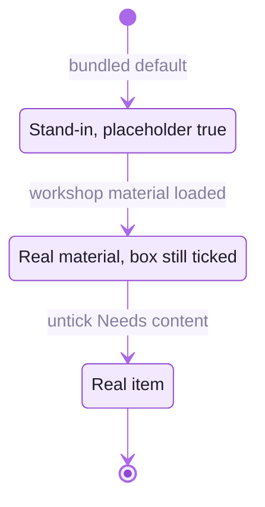

<picture>
  <source media="(prefers-color-scheme: dark)" srcset="readme-kit/assets/divider-dark.svg">
  
</picture>

# &nbsp; Content still needed from the workshop

The pavilion never tells visitors that anything is missing. Where the workshop's own material has not arrived, an
item shows a neutral stand-in of itself, or is hidden: pieces carry a form title ("Water Pot — Study"), their
description says they were made for this exhibition in the manner of a tradition, and no tradition is named until the
list is confirmed. This list is what is still needed to replace those stand-ins. In the admin, untick **Needs content
from the workshop** on each item once its real material is in. For makers, untick **Hidden from visitors**.

The admin's **Checklist** page lists, per item, what is still missing and exports it as a CSV for the workshop.

## The traditions

| What | Where in the pavilion | What is shown meanwhile |
|---|---|---|
| Confirmation of the twenty-one traditions, their names, places and captions (`src/museum/content/crafts.ts`), then `CRAFTS_CONFIRMED = true` in `content/review.ts` | every piece's description, the Red Room's bays, the Parikrama niches | form titles and the region bay headers; names and captions only in curator review (`/gallery?review`) |
| Confirmation of the three gallery traditions (Bankura terracotta, Molela clay plaques, Longpi pottery) | Galleries A, B, C, the *Three traditions of clay* panel, the landing page, the tour | the working titles |
| Craft-cluster locations for the India map | Clay Atlas | the map without pins; pins are drawn only for confirmed places |
| Native-speaker review of the Hindi and Bengali captions | everywhere | working translations |

## The pieces

| What | Where in the pavilion | What is shown meanwhile |
|---|---|---|
| 3D scans or photographs and details of the 14 podium pieces (`clay-a-horse`, `clay-a-horse-small`, `clay-a-pot`, `craft-bankura-podium-plaque`, `clay-b-plaque-rider`, `clay-b-cups`, `clay-b-plaque-deity`, `clay-b-lamp`, `clay-b-plaque-serpent`, `craft-molela-podium-pot`, `clay-c-kettle`, `clay-c-bowl`, `clay-c-pot`, `craft-longpi-podium-bowl`) | the podium row, A → B → C | modelled pieces |
| The Herd: nine Bankura horses | Gallery A, on the three-step plinth | modelled horses |
| Plaques for the five niches of the white wall, and a plaque in progress for the maker's table | Gallery B | modelled plaques |
| Black ware for the island | Gallery C | modelled pots |
| Pieces for the upper register (24 on brackets) and the 12 relief panels | over A, B and C, seen from the balcony | modelled pieces and panels |
| Two guardian horses | Entrance Forecourt | modelled Ayyanar-style horses |
| The niche figure | Oculus Court, F's court face | a modelled figure |
| The lippan wall, 25 m of mud-and-mirror relief | Entry Ways, the corridor between H and F | a modelled relief |
| One piece per tradition for the Parikrama niches | Parikrama Walk | modelled pieces |
| A Kumartuli figure in progress and five Majuli masks | Agni Theatre lobby | modelled figure and masks |
| The survey: pieces for the five regional bays and the Andro coil pot cut open | The Red Room | modelled pieces |
| Everyday ware for the round table | The Earth Room | modelled pots |
| Pieces by potters, with makers and links | The Haat | modelled pieces, no links |
| Photographs and details of the hung works (`public/artworks/clay-*.jpg`; one hangs now, `clay-c-01` on Gallery C's curved wall) | Gallery C | a generated study |

## Text, films, makers and partners

| What | Where in the pavilion | What is shown meanwhile |
|---|---|---|
| Review of the wall panels: *Three traditions of clay*, the three tradition panels, the five making panels (prepare, form, dry, fire, finish) and the statement *Earth, water, hand and fire* | the description wall, Entry Ways, Galleries B and C, Wine Hall | the panels as written from general sources (modest, factual) |
| Review of the exhibition title and introduction on the description wall | the description wall H, at the end of the Earth Room | "Clay Traditions", *Earth, water, hand and fire*, with a short introduction |
| Films of the making, if any | no screen is installed in the galleries yet; one fits the Wine Hall or the Earth Room | nothing; the Agni Theatre plays its generative kiln film, which names no place, person or process step |
| Maker profiles (name, cluster, biography, portrait, links), with the maker's consent | "Meet the maker" cards, `/makers/<id>` | nothing: the three stand-in profiles (`clay-maker-placeholder-a` to `-c`) are hidden from visitors |
| Final partner credit wording and any further partners | the entrance panel, the Clay Atlas, the landing page | DC Handicrafts, presenting, and IIT Kharagpur, in collaboration |

## Before launch

- Replace stand-in images by name (`public/artworks/clay-*.jpg`) or, better, through the admin, so curators can see
  what changed in the item's history. `scripts/generate-placeholders.mjs` never overwrites a file without `FORCE=1`.
- The database keeps what it was seeded with. Content seeded before the grand rotunda carries no layout epoch, and
  the pavilion then keeps its bundled objects and tour and warns in the console; **Content → Reset to defaults…**
  brings the current defaults into the database and keeps everything it replaces in the trash. Read **Activity**
  for curator edits before resetting.
- When the list is confirmed, set `CRAFTS_CONFIRMED` and deploy; until then curators check names and captions with
  `?review`.

<picture>
  <source media="(prefers-color-scheme: dark)" srcset="readme-kit/assets/footer-dark.svg">
  
</picture>
