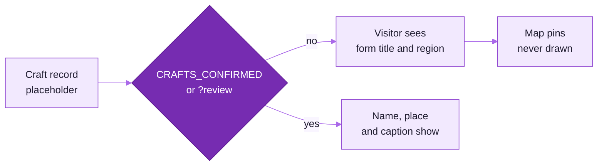
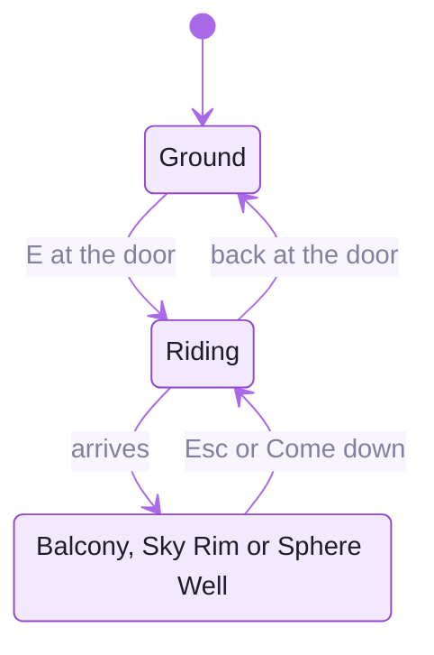
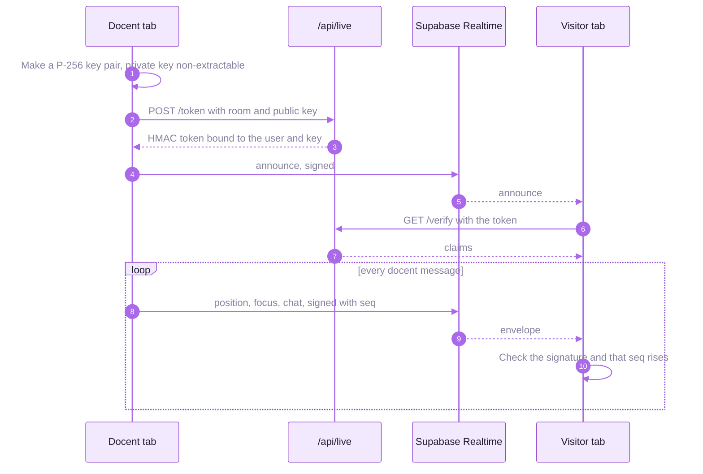

<picture>
  <source media="(prefers-color-scheme: dark)" srcset="readme-kit/assets/divider-dark.svg">
  
</picture>

# &nbsp; Pavilion guide

How the clay rotunda is built and how to change it: the spaces, the traditions, the content config, frames,
light, rides, moments, live tours and XR. Everything a curator can change at runtime is also in the admin; this
guide is for the code and the bundled defaults in `src/museum/config`.

| Section | What it covers |
|---|---|
| [Controls and URL parameters](#controls-and-url-parameters) | keys, mouse, touch and the query switches |
| [Pages outside the 3D view](#pages-outside-the-3d-view) | landing, guide, QR labels, maker pages, credits |
| [The building](#the-building) | the drawings, the spaces, coordinates and dimensions |
| [The traditions](#the-traditions) | the twenty-one records, where their pieces stand, curator review |
| [Project structure](#project-structure) | where each part of the scene lives |
| [Content](#content) | hung works, podium pieces, surfaces and scans |
| [Automatic frames](#automatic-frames) | how a frame is sized from the image |
| [Light and graphics](#light-and-graphics) | time of day, weather, diyas, path tracing, tiers |
| [Rides, moments and the passport](#rides-moments-and-the-passport) | perches, the kiln film, cues, stamps |
| [Live tours, presence, VR and AR](#live-tours-presence-vr-and-ar) | the social and immersive layer |
| [Validation scripts](#validation-scripts) | screenshots, interaction, load profile, visual regression |
| [Design assumptions](#design-assumptions) | what the drawings leave open |

## Controls and URL parameters

| Input | Action |
|---|---|
| Drag, or **L** for mouse-look with a crosshair | look around |
| **W A S D**, **↑ ↓** | walk; **← →** turn; **Shift** walks briskly |
| Click the floor | walk there |
| Click a piece, panel or work | open its details |
| **E** | the nearest item, a stamp post, or a ride's door |
| **M**, **H**, **T**, **P** | map, help, cycle the time of day, photo mode |
| **Space**, **]** | pause the guided tour, next stop |
| **Esc** | close help, then the item panel, then the tour; on a ride, come down |
| Touch | on-screen joystick, drag to look, tap a room on the map to travel |

| Parameter | Effect |
|---|---|
| `?quality=low\|medium\|high\|ultra\|auto` | force a graphics tier (also in the HUD) |
| `?autostart` | skip *Enter* once loading completes; `&tour` starts the guided tour |
| `?static` | ignore the backend: bundled content, social features hidden |
| `?lang=en\|hi\|bn` | English, Hindi or Bengali |
| `?review` | curator review: every tradition's name, place and caption shows (this site only) |
| `?noarrival` | skip the arrival flight (also skipped with `?autostart`, `?tour`, or after the first visit of the session) |
| `?perch=0` | no rides for this session |
| `?spectacle=off` | the Lite form of every moment: no shafts, motes, halos, mirror, smoke or grade |
| `?reducedMotion` | the Still form: no camera moves, spins, flicker or particles |
| `?nolive`, `?noanalytics` | no presence or live tours; no analytics events |
| `?renderer=webgpu` | experimental WebGPURenderer when `navigator.gpu` exists; falls back to WebGL |
| `?probes` | experimental per-zone irradiance probes, Medium and up |
| `?debug` | dev only: FPS and GPU stats, collision shapes, coordinates |
| `?quality=high&fx=0&shadows=0&area=0&ao=0&dpr=1` | dev only: profiling overrides |

Old links that put these parameters on `/` are redirected to `/gallery` with them.

## Pages outside the 3D view

| Address | What |
|---|---|
| `/` | landing page: real frames of the pavilion and a hero film (`scripts/capture-landing.mjs`), the fifteen spaces, the experience |
| `/gallery`, `/gallery/<slug>` | the pavilion, default exhibition (`clay-traditions`) or another published one; `/e/<slug>` redirects |
| `/gallery#<kind>=<id>` | deep link to an artwork, object, exhibit, infographic, video or zone, such as `#zone=ring-b` or `#object=clay-a-horse` |
| `/guide?lang=` | the accessible, printable text guide, space by space |
| `/qr/<kind>/<id>` | a printable QR label that links a physical piece to its place in the pavilion |
| `/makers/<id>` | a maker's server-rendered profile (hidden while the profile is a stand-in) |
| `/credits` | every sourced model and material, with its author, source and licence |
| `/admin` | the admin (see [BACKEND.md](BACKEND.md)) |

## The building

The *Clay exhibition layout* drawings (sectional plan, top 3D view, elevation, front entrance spawn point) label
the drum "Dia 70 ft (approx)", the entrance G "15 ft", the elevation "Height 20 ft, duplex" and the podiums
"12 in × 12 in at 4 ft". The build keeps their organisation and grows them into a rotunda. Scale is
**1 unit = 1 metre**; axes are +x east, +y up, **−z north**. The drawing's annex points east; the app turns it a
quarter so the entrance faces +z and the visitor walks in facing north. Plan angles are measured from +x towards +z
(`polar(r, aDeg)` in `config/museum.ts`).

```mermaid
%%{init: {"theme":"base","fontFamily":"Inter, ui-sans-serif, system-ui, -apple-system, Segoe UI, Roboto, Helvetica, Arial, sans-serif","themeVariables":{"fontSize":"15px","primaryColor":"#F2E9FE","primaryTextColor":"#1E1B2E","primaryBorderColor":"#9148D2","secondaryColor":"#FAEECD","secondaryTextColor":"#1E1B2E","secondaryBorderColor":"#CD9200","tertiaryColor":"#F3F1FA","tertiaryTextColor":"#1E1B2E","tertiaryBorderColor":"#A7A3BC","mainBkg":"#F2E9FE","nodeBorder":"#9148D2","nodeTextColor":"#1E1B2E","lineColor":"#AA69E9","textColor":"#857F9E","edgeLabelBackground":"#F9F5FF","clusterBkg":"#F9F5FF","clusterBorder":"#D6B6FB","titleColor":"#762CB1","noteBkgColor":"#FAEECD","noteTextColor":"#1E1B2E","noteBorderColor":"#CD9200","actorBkg":"#F2E9FE","actorBorder":"#9148D2","actorTextColor":"#1E1B2E","actorLineColor":"#AA69E9","signalColor":"#AA69E9","signalTextColor":"#857F9E","labelBoxBkgColor":"#F2E9FE","labelBoxBorderColor":"#9148D2","labelTextColor":"#1E1B2E","loopTextColor":"#857F9E","activationBkgColor":"#E7D5FE","activationBorderColor":"#9148D2","sequenceNumberColor":"#FFFFFF","transitionColor":"#AA69E9","transitionLabelColor":"#857F9E","stateLabelColor":"#1E1B2E","stateBkg":"#F2E9FE","compositeBackground":"#F9F5FF","compositeTitleBackground":"#F2E9FE","attributeBackgroundColorOdd":"#FFFFFF","attributeBackgroundColorEven":"#F9F5FF","relationColor":"#AA69E9","relationLabelBackground":"#F9F5FF","relationLabelColor":"#1E1B2E"}}}%%
flowchart TB
  subgraph NW["North wing · crescent rooms off the Parikrama"]
    direction LR
    AT["Clay Atlas"]
    TH["Agni Theatre"]
    RR["The Red Room"]
    HT["The Haat"]
  end
  PK["Parikrama walk<br/>open to the sky"]
  subgraph RO["The rotunda · dome 32 m across"]
    direction LR
    GC["Gallery C<br/>Longpi"]
    GB["Gallery B<br/>Molela"]
    GA["Gallery A<br/>Bankura"]
    OC["Oculus Court<br/>lotus pool"]
    WH["Wine Hall<br/>hallway D"]
    EW["Entry Ways E<br/>walls H and F"]
  end
  ER["The Earth Room<br/>annex G"]
  FC(["Forecourt"])
  SW["The Sphere Well<br/>sunk in the plinth"]
  NW --- PK
  PK --- RO
  RO --- ER
  ER --- FC
  FC -.- SW
  classDef accent fill:#762CB1,stroke:#5F1C93,color:#FFFFFF
  classDef gold fill:#FAEECD,stroke:#CD9200,color:#1E1B2E
  class OC accent
  class SW gold
```



| Space | Zone id | What is there |
|---|---|---|
| Entrance Forecourt | `entrance-court` | the spawn point 29 m outside the door, facing in; two tall Ayyanar guardian horses flanking the approach; the landscape plinth (33.8 m radius) and the paved forecourt |
| The Earth Room | `annex` | annex G, 30 ft clear: eroded clay formations, curved shelves of everyday pots and a round table under a round roof light |
| Entry Ways | `entry-e` | the ambulatory either side of the annex mouth, the E arches and the corridor between H and F: the title wall, the 25 m lippan relief of mud and mirror, the strata |
| Oculus Court | `inner` | the pool and the red lotus under the 10 m oculus, the brass floor ring, the niche figure on F's court face |
| Gallery A | `ring-a` | Bankura terracotta: four podiums against the red wall and The Herd, nine horses on a three-step plinth |
| Gallery B | `ring-b` | Molela plaques: six podiums, plaques in the five niches of the white wall, a maker's table with a plaque in progress |
| Gallery C | `ring-c` | Longpi pottery: four podiums, the black ware island under one cool beam, works on the curved wall |
| Wine Hall | `hallway-d` | *Clay Elsewhere*: credited scans of clay from other places and times on the wine plinths, a relief on the end wall |
| Parikrama Walk, west and east | `parikrama-west`, `parikrama-east` | the serpentine walk between red walls, sunken gardens and courtyards, one tradition's piece in each niche |
| Clay Atlas | `atlas` | the map of India, the constellation of tradition vessels, the partners' panel |
| Agni Theatre | `theatre` | the kiln film on a curved screen under a brick vault; a Kumartuli figure in progress and five Majuli masks in the lobby |
| Kothi, the Red Room | `library` | the survey: five regional bays on red shelves round an Andro coil pot cut open under a disc of sky |
| The Haat | `shop` | pieces on shelves and tables under clay lanterns |
| The Balcony | `duplex` | the duplex ring at 4.6 m round A, B and C, with the upper register of niches and reliefs; reached by ride |
| Sky Rim | `sky-rim` | the deck round the oculus collar, 20 m above the lotus; reached by ride |
| The Sphere Well | `sphere-well` | a round red room 8 m under the plinth, a spiral stair round a hanging clay sphere; reached by ride |

| Element | Size | Source |
|---|---|---|
| Gallery ring | interior face 16.0 m radius (Ø 105 ft, 1.5 × the drawing's 70 ft) | `MUSEUM.drum.ringR` |
| Lobe round the annex | interior face 21.75 m (the ring ÷ 0.735, the drawing's ratio) | `MUSEUM.drum.r` |
| Drum | parapet 10 m, ambulatory clear 9 m | `MUSEUM.pavilion` |
| Dome | springs at 9 m, rises 12 m, collar top 22.2 m; 5 rings of 28 coffers, 24 ribs | `MUSEUM.dome` |
| Oculus | 5 m radius, three stepped terraces, a light well above | `MUSEUM.dome.terraces`, `MUSEUM.oculus` |
| Annex G | 30 ft clear, door 3.6 m × 6 m, end face at z 34.5 | `MUSEUM.annex` |
| Description wall H | on the ring circle between the E arches, 9 m | `MUSEUM.descriptionWall` |
| Inner main wall F | r 12.1 m, 30° to 150°, 7 m, eight piers and a lit niche | `MUSEUM.innerMainWall` |
| Podiums | 12 in × 12 in × 4 ft, 14 on a 15.1 m circle (4 in A, 6 in B, 4 in C) | `MUSEUM.podium` |
| Balcony | walking level 4.6 m, half the clear height (the drawing's band) | `MUSEUM.balcony` |
| North wing | crescent rooms between r 23.35 and 33.25, the Parikrama from −136° to 35° | `config/satellites.ts` |

Every derived coordinate (`KEY`, `ARCH`, walls, zones, surfaces, podium slots) is computed in
`src/museum/config/layout.ts` and `config/satellites.ts`, never typed by hand; `tests/unit/grand-literals.test.ts`
holds scene positions to expressions of those constants.

## The traditions

`src/museum/content/crafts.ts` holds twenty-one records. A, B and C are the drawing's three deep dives; the other
eighteen are a survey, gathered mostly in the Red Room's five regional bays.

| Bay | Traditions |
|---|---|
| East | Bankura terracotta (Gallery A), Kumartuli clay images, Bishnupur temple terracotta, Odisha terracotta |
| West | Molela clay plaques (Gallery B), Khavda pottery, Lippan mud-mirror work, Pokaran pottery, Jaipur blue pottery |
| North-East | Longpi pottery (Gallery C), Asharikandi terracotta, Andro pottery, Majuli masks |
| North | Khurja pottery, Chinhat pottery, Nizamabad black pottery, Gorakhpur terracotta, studio pottery |
| South | Manamadurai pottery, Ayyanar horses, Villianur terracotta |



Every record and every piece is a placeholder until the workshop confirms it. Visitors see a descriptive form
title ("Coil-built Pot, Cut Open — Study") and the region bay headers; names, places and captions appear only
with `?review` (this site only) or once `CRAFTS_CONFIRMED` in `content/review.ts` is set. Map pins are never drawn
for these records. Scans of objects from elsewhere (the Wine Hall) carry their own museum's credit and are never
given an Indian tradition's name.

Where the pieces stand is set in `config/grandObjects/crafts.ts`: the guardian horses on the forecourt, the
podiums and islands of A, B and C, 24 pieces and 12 Bishnupur-style relief panels in the upper register, the
niche figure on F, the lippan wall, the Wine Hall plinths, a piece per tradition in the Parikrama niches, the
theatre lobby, the Red Room's bays and the Earth Room's table.

## Project structure

```
src/site.ts      which museum this build is (SITE.id = 'clay')
src/museum/
  config/        all content and constants: museum (dimensions), layout (walls, zones, surfaces, podiums),
                 satellites (north wing, Sphere Well, east stair), artworks, objects, grandObjects/,
                 spectacleObjects/, infographics, amenities, lighting, quality, tour, plan, videos
  content/       crafts (the 21 records), review (curator review), artisans, exhibition, loader
  architecture/  drum, dome and oculus, arches, balcony, Parikrama, crescent rooms, Red Room, Sphere Well, landscape
  models/        procedural clay models (vessels, horses, plaques, lotus, sphere, kiln, masks) and sourced GLBs
  lighting/      sun and sky, track lights, spot pool, atmosphere (shafts, motes), diyas, monsoon weather
  materials/     procedural PBR, triplanar clay, lime bands, water and planar mirror
  spectacle/     cues, moments, music, the Full, Lite and Still forms
  media/         the kiln film, video screens, soundscape and spatial audio
  navigation/    visitor controller, collision, perches (rides), arrival flight, zone culling
  tour/          guided tour engine and pathing          trail/   the clay passport and its stamps
  live/          presence, docent tours, chat            xr/      VR rig, AR view
  studio/        the potter's wheel (taken down for now) staff/   in-museum tools for curators
  ui/            entry screen, HUD, info panel, minimap, help, light and weather, photo mode
  i18n/          English, Hindi, Bengali                 a11y/    accessibility layer and settings
  share/         deep links and QR codes                 pwa/     service worker
  api/ analytics/ effects/ exhibits/ state/              backend client, tracker, post FX, frames, stores
app/             Next.js pages: landing, gallery, guide, qr, makers, credits, admin, api/**/route.ts, media
src/admin/       the admin client app (byte-identical with the hand block museum's)
src/server/      backend: database, storage, auth, content store, handlers
public/          artworks, models (cc0, sourced), textures, audio, brand, landing frames
```

## Content

### Hung works

The hang is a few large frames; the walls belong to the objects. `ARTWORKS` in `src/museum/config/artworks.ts`
builds each stand-in with `work()`:

```ts
work('c', 'clay-c-02', ['Bowl — Study', 'कटोरा — अध्ययन', 'বাটি — চর্চা'], { surface: 'c-south-1', at: midAt('c-south-1'), centerHeight: 1.75 }, {
  maxWidth: 1.4, maxHeight: 1.8, frame: 'dark-wood', alt: '…', altHi: '…', altBn: '…',
})
```

Every surface is a straight run cut from the curved walls as facets, so `at` is metres along the run from its
start (the admin calls it "metres along wall"). `atAngle(surface, aDeg)` gives the `at` where a plan angle meets a
surface and `midAt(surface)` its middle. `centerHeight` defaults to 1.6 m; `physicalWidth` (metres) hangs a work at
true size. To replace a stand-in, drop the photograph in under the same name (`public/artworks/clay-*.jpg`) or set
`image:`, fill in the real metadata and set `placeholder: false` (in the admin: untick *Needs content from the
workshop*).

> [!WARNING]
> `scripts/generate-placeholders.mjs` draws the studies in headless Chrome and never overwrites a file without
> `FORCE=1`, so photographs dropped in under the same names are safe from a re-run.

| Surfaces | Wall |
|---|---|
| `a-outer-1` to `a-outer-3`, `b-outer-1` to `b-outer-4`, `c-outer-1`, `c-outer-2` | the gallery ring wall behind the podiums |
| `c-south-1` to `c-south-3` | Gallery C's south flank, inside the hallway wall |
| `d-hallway-1` to `d-hallway-6`, `d-inner-1` to `d-inner-3` | the Wine Hall: the lobe wall and the hallway wall |
| `e-north-1` to `e-north-3`, `e-south-1` to `e-south-3` | the entry ways, either side of the annex mouth |
| `h-east`, `h-description`, `h-west`, `h-inner-1` to `h-inner-4` | the description wall H; the title sits on `h-description` |
| `f-outer-1` to `f-outer-5`, `f-inner-1`, `f-inner-2`, `f-inner-main`, `f-inner-3`, `f-inner-4` | the inner main wall F, corridor and court faces |
| `g-east`, `g-west`, `g-facade-east`, `g-facade-west` | the annex walls and the entrance front |
| `th-screen` | the Agni Theatre's curved screen |

### Podium pieces and scene objects

Pieces on the podiums are scene objects. `PODIUM_PIECES` in `config/objects.ts` takes a slot (`pod-a-1` to
`pod-c-4`), a procedural kind (`clay-vessel` with `form`, `clay` and `burnish`, `terracotta-horse`,
`votive-plaque` with `motif`) and a height; the piece stands on the podium top facing the court. The other
pieces, islands and furniture live in `config/grandObjects/` and `config/spectacleObjects/`.

To show a scan instead, set the object's `model` to a GLB; the procedural `kind` stays as the loading and error
fallback. Scans from a phone go through the admin's *3D scan import*: see [CONTENT_CAPTURE.md](CONTENT_CAPTURE.md).
Freely licensed models from elsewhere go through `node scripts/optimize-sourced.mjs`, which writes LOD0 and LOD1
GLBs into `public/models/sourced`, `CREDITS.json` and `config/sourcedRegistry.generated.ts`, and fails above 45 MB
in all or 4 MB a file (5 MB for trees); `scripts/verify-sourced.mjs` checks the budgets.

### Deep zoom

Admin → *Capture tools* → *Deep zoom* tiles a large photograph into a DZI pyramid in the browser and sets the
artwork's `deepZoom`. Visitors open it with **Examine closely** or a double-click: OpenSeadragon with zoom, pan,
full screen, keyboard and a centimetre scale bar when `physicalWidth` is set.

## Automatic frames

`exhibits/Artwork.tsx` and `exhibits/frameMath.ts` size every frame from the image itself.

```mermaid
%%{init: {"theme":"base","fontFamily":"Inter, ui-sans-serif, system-ui, -apple-system, Segoe UI, Roboto, Helvetica, Arial, sans-serif","themeVariables":{"fontSize":"15px","primaryColor":"#F2E9FE","primaryTextColor":"#1E1B2E","primaryBorderColor":"#9148D2","secondaryColor":"#FAEECD","secondaryTextColor":"#1E1B2E","secondaryBorderColor":"#CD9200","tertiaryColor":"#F3F1FA","tertiaryTextColor":"#1E1B2E","tertiaryBorderColor":"#A7A3BC","mainBkg":"#F2E9FE","nodeBorder":"#9148D2","nodeTextColor":"#1E1B2E","lineColor":"#AA69E9","textColor":"#857F9E","edgeLabelBackground":"#F9F5FF","clusterBkg":"#F9F5FF","clusterBorder":"#D6B6FB","titleColor":"#762CB1","noteBkgColor":"#FAEECD","noteTextColor":"#1E1B2E","noteBorderColor":"#CD9200","actorBkg":"#F2E9FE","actorBorder":"#9148D2","actorTextColor":"#1E1B2E","actorLineColor":"#AA69E9","signalColor":"#AA69E9","signalTextColor":"#857F9E","labelBoxBkgColor":"#F2E9FE","labelBoxBorderColor":"#9148D2","labelTextColor":"#1E1B2E","loopTextColor":"#857F9E","activationBkgColor":"#E7D5FE","activationBorderColor":"#9148D2","sequenceNumberColor":"#FFFFFF","transitionColor":"#AA69E9","transitionLabelColor":"#857F9E","stateLabelColor":"#1E1B2E","stateBkg":"#F2E9FE","compositeBackground":"#F9F5FF","compositeTitleBackground":"#F2E9FE","attributeBackgroundColorOdd":"#FFFFFF","attributeBackgroundColorEven":"#F9F5FF","relationColor":"#AA69E9","relationLabelBackground":"#F9F5FF","relationLabelColor":"#1E1B2E"}}}%%
flowchart LR
  I["Image loads<br/>pixel width, height"] --> F{"physicalWidth<br/>set?"}
  F -->|yes| P["Size 1:1<br/>from metres"]
  F -->|no| T["Fit inside<br/>max size minus borders"]
  P --> M["Mat and frame<br/>around the image"]
  T --> M
  M --> G["Moulding, mat board,<br/>recessed image plane"]
  G --> L["Spotlight cone<br/>and wall label"]
  classDef accent fill:#762CB1,stroke:#5F1C93,color:#FFFFFF
  class M accent
```



The aspect ratio is never changed. A missing image renders an intentional *Image unavailable* card instead of
breaking the scene. Frame styles in `config/frames.ts`: `frameless`, `textile-panel`, `thin-black`, `white`,
`natural-wood`, `dark-wood`, `brass-slim`, `float-walnut`.

## Light and graphics

| Feature | Where | How it works |
|---|---|---|
| Time of day | HUD, **T**, *Light and weather* | Morning, Midday, Golden hour, Dusk, Night (`config/lighting.ts`). The circle of daylight from the oculus moves across the court and the lotus opens with the sun. The sun dial can follow Kharagpur time. |
| Weather | *Light and weather* | monsoon rain (`lighting/weather`) |
| Diyas | `config/diyas.ts`, `lighting/diyas` | oil lamps lit at dusk |
| Track light | `LIGHTING.track` | 3000 K, partly adapted towards neutral, as the drawings' "warm white to neutral" asks |
| Ray-traced photos | photo mode, `effects/PathTracer.tsx` | hold still and the view is progressively path-traced with three-gpu-pathtracer; the BVH builds in a worker from the zones shown; any failure falls back to raster. Photo mode also offers framed views (the dome's eye, the herd, the Red Room). |
| Arrival flight | `navigation/ArrivalFlight.tsx` | *The wheel turns*: high over the oculus, round the crescent roofs, down to the annex door; 13 s on Medium and up, 8 s on Low, three held views for reduced motion; first entry of a session only, skippable |
| WebGPU | `?renderer=webgpu`, `utils/renderer.ts` | experimental; the composer, probes and path tracer are WebGL-only and skipped |
| Adaptive quality | `config/quality.ts`, `src/App.tsx` | `detectInitialTier()` picks the start; the pavilion steps down below about 32 fps, and on Low below about 30 fps switches the spectacle to Lite |

| Tier | Shadows | Composer | Spot pool | Texture size | Pool mirror | Floor reflections |
|---|---|---|---:|---:|:---:|:---:|
| Low | · | · | 6 | 512 | · | · |
| Medium | 2048, soft | · (native MSAA) | 10 | 1024 | · | · |
| High | 4096, soft | AO, bloom, SMAA | 12 | 1024 | ✓ | · |
| Ultra | 4096, soft | high AO, bloom, SMAA | 14 | 2048 | ✓ | ✓ |

## Rides, moments and the passport

The visitor never walks on a roof, a balcony or a stair. Three perches are ridden on rails
(`navigation/perch.ts`); **Esc** or *Come down* rides back to the door.



| Perch | Door | Ride |
|---|---|---|
| The Balcony | the east stair, in the east ambulatory | up the lower flight, over the bridge through the E-east arch, round the balcony arc |
| Sky Rim | the east stair | up both flights, out of the roof hatch, across the roof and up the dome's rib stair |
| The Sphere Well | the rim balustrade on the plinth, south-west of the drum | down through the opening and round the spiral stair to the floor, looking up at the sphere |

| Piece | Where | How |
|---|---|---|
| Guided tour | `config/tour.ts`, captions in `i18n/tourText.ts` | 21 stops in six chapters, Earth to Fire: earth, water, hand, air, fire and the return. Stops may fire cues (music, light, effects, a time of day); the balcony and the Sphere Well stops are seen from their perches; the theatre stop waits for the film's chapter to end. |
| Moments | `spectacle/moments.ts`, `spectacle/momentList.ts` | named cues such as the turn into the court, replayable from *Help → Moments*, playable by a docent for a live tour; each plays a Full, Lite or Still form |
| Kiln film | `media/projection/kilnFilm.ts` | *Earth · Water · Hand · Fire · Ash*, five chapters drawn by one shader on the theatre screen; it names no place, person or process step |
| Clay passport | `trail/passport.ts` | stamp posts press a Molela-style roundel into the visitor's clay tablet; the perches and the Red Room award the rest; stored on the device only (`clay.passport.v1`) |
| Potter's wheel | `studio/`, `GRAND_FLAGS.clayStudio` | taken down for the time being; the flag restores the wheel and the Visitors' Shelf |

## Live tours, presence, VR and AR



| Feature | How |
|---|---|
| Presence | other visitors appear as soft silhouettes with a name tag. Needs `NEXT_PUBLIC_SUPABASE_URL` and `NEXT_PUBLIC_SUPABASE_ANON_KEY`; the room is `clay-pavilion` unless `NEXT_PUBLIC_LIVE_ROOM` says otherwise; hidden when Realtime is not reachable. The invitation folds to a dot after a few seconds. |
| Live docent tours | curators and admins get **Start live tour**. Joined visitors follow the docent, see a ring on what is being shown, chat (rate-limited, filtered, mutable) and raise a hand. Protocol and threat model: [API.md](API.md#live-guided-tours--presence). |
| VR | **Enter VR** when `immersive-vr` is supported: true scale, teleport, snap turn, world-space info card; rides become a two-step teleport. |
| AR | inspection viewer → **View in your space**: WebXR `immersive-ar` on Android Chrome, AR Quick Look on iOS and iPadOS; hidden elsewhere. |
| Staff mode | signed-in curators get in-pavilion placement and tour-stop tools (`src/museum/staff/`), loaded only for staff. |

## Validation scripts

These need Chrome and a running server; CI runs the unit tests, the Postgres query counts and visual regression.

| Script | Checks |
|---|---|
| `node scripts/screenshots.mjs [baseUrl] [quality]` | the demo path, with console errors, into `scripts/out/` |
| `node scripts/grand-shots.mjs` | every acceptance pose in `scripts/grand-poses.json` at each tier; any console error fails it |
| `node scripts/capture-landing.mjs` | the landing frames and hero film into `public/brand/landing`, and `app/landing/captured.json` |
| `node scripts/interaction-test.mjs` | walking, collision, click to panel, 3D inspection |
| `node scripts/load-profile.mjs` | load time, long tasks, transfer by type |
| `node scripts/live-presence-test.mjs`, `node scripts/xr-emulator-test.mjs` | presence and a live tour across two browsers; the XR emulator |
| `npm run optimize:assets` | meshopt and WebP GLBs, WebP artwork variants, then a render check |
| `npm run test:visual` | screenshots against `tests/visual/baseline` ([tests/visual/README.md](../tests/visual/README.md)) |

## Design assumptions

The drawings are concept sketches without a dimension grid. What they leave open, and what the build chose:

| Topic | Choice |
|---|---|
| Scale | "Dia 70 ft" and the 15 ft entrance agree at one scale only if 70 ft is the large lobe round the annex; the gallery ring is the smaller circle, at the drawing's 0.735 ratio. The grand plan then scales the ring to 1.5 × (Ø 105 ft, 32 m) and the annex to 30 ft. |
| Height | the drawing's 20 ft drum becomes a 10 m parapet under a coffered dome to 22 m; "duplex" is the balcony at half the clear height, ridden, never walked |
| H, E, F, D | H the free-standing description wall at the annex mouth; E the two ways round its ends; F the taller oxblood arc that withholds the court until the turn; D the hallway between the drum and its inner wall |
| Oculus | the drawing's concentric rings become a stepped oculus over a still pool with a lotus island |
| Podiums | 12 in × 12 in × 4 ft, as drawn, 14 on one circle; formation gates of eroded clay separate the galleries |
| Mood boards | each one is a room: the eroded formations, the lotus under the oculus, the round red room of shelves, the spiral round a sphere, the wine-red hallway, the white niche wall, the planted walks |
| Palette | terracotta, rose clay and ochre from the inspiration page, with oxblood walls, lime bands and warm-to-neutral pools of light |
| Content | every piece and caption is a stand-in until the workshop confirms it; nothing is passed off as a documented object |

<picture>
  <source media="(prefers-color-scheme: dark)" srcset="readme-kit/assets/footer-dark.svg">
  
</picture>
